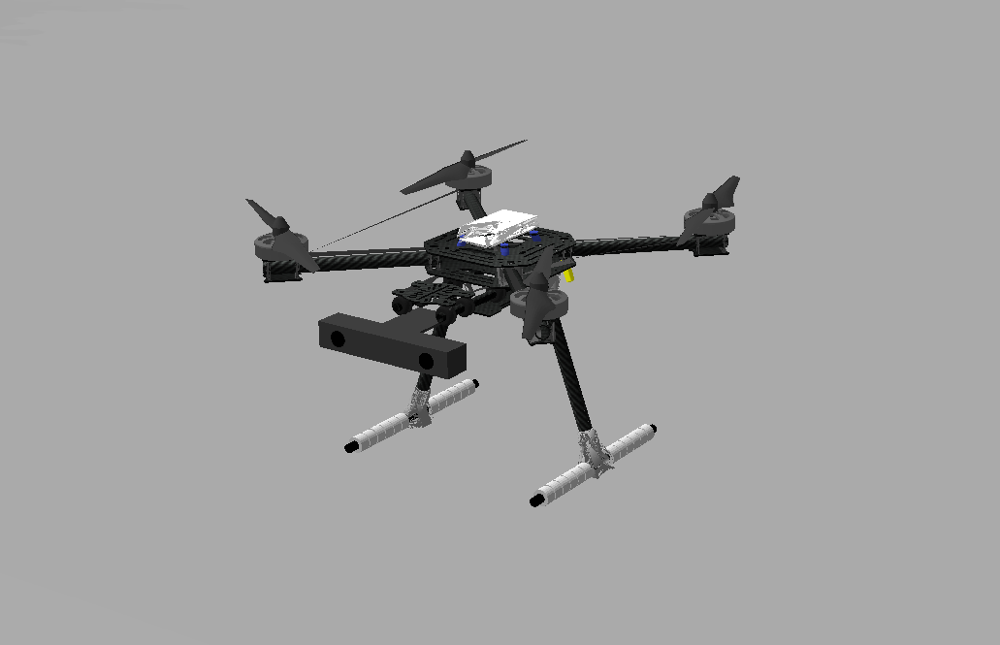

<div align="center">

# SkyInterceptor

**An autonomous drone stack for aerial filming and counter-drone interception, built from scratch on ROS 2 and simulated in Gazebo.**


</div>

<p align="center">
  <br>
  <i>Flying the drone with the keyboard in Gazebo</i>
</p>

## Overview

SkyInterceptor is a simulated drone that can switch between two missions sharing one perception → tracking → control pipeline:

| | **FOLLOW** (aerial filming) | **INTERCEPT** (counter-UAS) |
|---|---|---|
| Goal | Follow a person, bicycle or car and keep them framed | Capture an intruding small drone |
| Valid targets | `person`, `bicycle`, `car` | `uav` only; ground targets are never engaged |
| Planner | `follow_planner_node`: the framing presets BEHIND / SIDE / LEAD / ORBIT, in the target's heading frame | `intercept_guidance_node`: proportional navigation with a terminal capture law |
| Safety rule | Never closer than `d_min` to any person or vehicle, or `d_obstacle_min` to any static obstacle | Same keep-out distances, and the engagement gate refuses anything that is not a confirmed `uav` |

Both planners publish a **velocity** setpoint on `/setpoint/raw`, and an independent **safety filter** has the final say on every setpoint: it owns `/setpoint/safe`, which is what the controller flies. Neither mission planner can command an unsafe motion.

## Highlights

- **Physics-based flight model.** Rotor thrust and torque (`T = k_f·ω²`), motor lag, airframe and rotor drag, wind with Gauss–Markov gusts and ground effect, all in a ROS-free C++/Eigen library that is unit-tested in a standalone 6-DOF simulation.
- **Realistic onboard controller.** Velocity PI → attitude P (SO(3)) → body-rate PI → motor mixer, wrapped as a Gazebo plugin that publishes `/odom` and TF.
- **Stereo-vision perception.** Time-synchronized stereo pair, SGBM depth, YOLOv8 detection and 3D back-projection of detections. The vision path works end to end, next to a ground-truth source for the runs that need one.
- **Multi-target IMM-EKF tracker.** CV / constant-acceleration / coordinated-turn models mixed by an IMM, chi-square gating, global-nearest-neighbour association and M-of-N track management, as a ROS-free library tested on synthetic trajectories, plus mode-aware target selection ([`docs/TRACKER.md`](docs/TRACKER.md)).
- **Two planners, one pipeline.** The follow planner frames a target from a preset with a smoothed heading and a lost-track machine; the intercept guidance flies pure PN (`a = N·V_c·λ̇`) or augmented PN with the target acceleration from the tracker, and its terminal capture law flies the last few metres instead of overflying the target ([`docs/FOLLOW.md`](docs/FOLLOW.md), [`docs/INTERCEPT.md`](docs/INTERCEPT.md)).
- **Safety filter with a measured barrier.** The keep-out is a control barrier function on the velocity, corrected for the lag of the autopilot's velocity loop, plus the speed, altitude and geofence limits and a latching e-stop ([`docs/SAFETY.md`](docs/SAFETY.md)).
- **A scripted intruder.** The target drone flies one of five behaviours — hover, waypoints, straight, weave or curve — so the guidance can be tested against repeatable manoeuvres.
- **Engineering discipline.** Fully containerized (CUDA 11.8 + ROS 2 Humble), GTest unit tests, ament linters, and CI that builds with `-Werror`.

## Demo

### The interception

A Crazyflie intruder flies a scripted behaviour — by default it accelerates from a
standstill and curves — while the interceptor climbs and engages it with
proportional navigation:

```bash
ros2 launch interceptor_drone intercept_demo.launch.py                  # augmented PN
ros2 launch interceptor_drone intercept_demo.launch.py guidance_law:=pn # pure PN
ros2 launch interceptor_drone intercept_demo.launch.py target_behaviour:=weave
```

The demo arms the mission on its own, so it runs unattended. It starts in the
middle of the park, with the interceptor behind the intruder, so the whole
engagement is in view of the Gazebo GUI and of the stereo cameras.

RViz shows the two drones as robot models, the tracks, the keep-out circles around
every person and obstacle and the guidance vectors in the world, and the left
camera, the right camera, the depth map and the detection overlay as image panels.
The guidance telemetry is on `/guidance/command` (the acceleration command, closing
speed, time to go, the zero-effort miss and the phase) and the line of sight and
commanded acceleration are drawn in RViz on `/guidance/vectors`. See
[`docs/INTERCEPT.md`](docs/INTERCEPT.md).

### The follow

```bash
ros2 launch interceptor_drone follow.launch.py   # the whole system in FOLLOW mode
```

The follow planner frames the walking person of the park from 8 m behind it
(`BEHIND` preset), and the safety filter keeps the drone 5 m away from every person
and every vehicle and 3 m from every static obstacle. The planner and the safety
filter are unit tested and the planner has been run live in the container; the
measured FOLLOW session (the framing score, the minimum distance and the track
retention over randomized runs) is the open P2.4 task. See
[`docs/FOLLOW.md`](docs/FOLLOW.md).

### Fly it yourself

Fly the drone yourself in two terminals (details in [Flying the drone](#flying-the-drone)):

```bash
make sim       # Gazebo, the park world with a walking person, and the drone
make teleop    # keyboard control: arm with t, take off with w
```

<table align="center">
  <tr>
    <td align="center"></td>
    <td align="center"></td>
  </tr>
  <tr>
    <td align="center"><i>The park world: drone, walking person, trees</i></td>
    <td align="center"><i>Drone model (Holybro X500 V2 look) with the stereo camera</i></td>
  </tr>
</table>

## Architecture

```
Perception  →  Estimation  →  Guidance  →  Safety  →  Control  →  Platform (Gazebo)
```

| Layer | Node | Purpose | Status |
|---|---|---|---|
| Perception | `stereo_sync_node` | Time-synchronizes the left/right camera images | ✅ Done |
| Perception | `stereo_depth_processor` | SGBM disparity → depth image | ✅ Done |
| Perception | `target_detector.py` | YOLOv8 object detection (Ultralytics) | ✅ Done |
| Perception | `target_3d_localizer` | Back-projects 2D detections to 3D positions | ✅ Done |
| Perception | `groundtruth_target_node` | Gazebo entity poses with noise, dropout and tree occlusion → `/target/detection_3d` (the alternative to vision) | ✅ Done |
| Estimation | `target_tracker_node` | IMM-EKF multi-target tracking and target selection (`/tracks`, `/target/state`) | ✅ Done |
| Guidance | `follow_planner_node` | FOLLOW framing presets, heading smoothing, lost-track machine → `/setpoint/raw` | ✅ Done |
| Guidance | `intercept_guidance_node` | Proportional navigation + the terminal capture law → `/setpoint/raw` | ✅ Done |
| Safety | `safety_filter_node` | Keep-out barrier, flight limits, e-stop, engagement gate → `/setpoint/safe` | ✅ Done |
| Control | `trajectory_controller_node` | Position PID → velocity, yaw P → `/cmd_vel` | ✅ Done |
| Mission | `mission_manager_node` | Mission mode (`/mission/set_mode` service, latched `/mission/mode`) | ✅ Done |
| Simulation | `target_drone_behavior_node` | Flies the intruder: hover, waypoints, straight, weave or curve | ✅ Done |
| Platform | `quadrotor_dynamics` (Gazebo plugin) | Rotors, aerodynamics, wind, ground effect, onboard flight controller; publishes `/odom` and TF | ✅ Done |
| Platform | `drone_teleop_keyboard.py` | Keyboard teleoperation | ✅ Done |
| Evasion | `evasion_controller_node` | Reserved for the target's own evasion strategies | 🚧 Stub |

The setpoint chain is the same in both modes:

```
follow_planner_node  ─┐
                      ├─► /setpoint/raw ─► safety_filter_node ─► /setpoint/safe ─► trajectory_controller_node
intercept_guidance_node ─┘                    ▲
                              /tracks, /odom, /mission/mode, /mission/estop
```

Only one of the two planners runs in a launch, and the follow planner publishes nothing at all outside the FOLLOW mode, so the two can never fight over `/setpoint/raw`.

## Roadmap

[`ROADMAP.md`](ROADMAP.md) is the source of truth for what is done and what is still to do: one section per task of [`IMPLEMENTATION_PLAN.md`](IMPLEMENTATION_PLAN.md), with the status, the branch and the notes of the work. `python3 scripts/roadmap.py ready` lists the tasks whose dependencies are all met.

What is still open, in order:

1. **P2.4** — the FOLLOW scenario harness and the metrics recorder (minimum distance, framing error, track retention).
2. **P3.4** — the rest of the engagement gate and the abort logic in the safety filter.
3. **P3.5** — the INTERCEPT scenario runner and the capture/abort metrics.
4. **P4** — the launch-file and mode-switch integration pass, and the last of the docs.

## Tech stack

| Area | Tools |
|---|---|
| Robotics | ROS 2 Humble, Gazebo Classic 11, TF2 |
| Languages | C++17, Python 3 |
| Libraries | Eigen, OpenCV (CUDA), Ultralytics YOLOv8 |
| Tooling | Docker, colcon, GTest, ament linters, GitHub Actions |

## Repository layout

```
SkyInterceptor/
├── Dockerfile, docker-compose.yml   # Dev container: CUDA 11.8 + ROS 2 Humble + Gazebo 11
├── docker/entrypoint.sh             # Container entrypoint (rosdep, env, welcome banner)
├── Makefile                         # All day-to-day commands (see below)
├── scripts/check.sh                 # The local mirror of CI (static checks + build + test)
├── scripts/roadmap.py               # Reads and validates ROADMAP.md
├── scripts/quick_test.sh            # Perception pipeline smoke test
├── ROADMAP.md                       # What is done and what is still to do
├── IMPLEMENTATION_PLAN.md           # The architecture, the topics, the messages, the parameters
├── DOCKER.md                        # Docker details, WSL2 GPU rendering, troubleshooting
├── docs/AGENT_PROMPTS.md            # Task prompts for coding agents
├── docs/TRACKER.md                  # The IMM-EKF, the track management, the target selection
├── docs/INTERCEPT.md                # The PN law, the capture law, the intruder
├── docs/FOLLOW.md                   # The framing presets, the lost-track machine
├── docs/SAFETY.md                   # The keep-out barrier, the flight limits, the gate
├── docs/FLIGHT_DYNAMICS.md          # Flight physics, flight controller, wind, teleop
├── .github/workflows/ci.yml         # CI: static checks + build & test
└── interceptor_ws/                  # ROS 2 (colcon) workspace
    └── src/
        ├── interceptor_interfaces/  # Custom messages (msg/) and services (srv/)
        └── interceptor_drone/       # Main package
            ├── include/             # common/, flight/, estimation/, guidance/,
            │                        # follow/, control/, safety/
            ├── src/
            │   ├── common/          # Shared library (interceptor_drone_lib)
            │   ├── perception/      # stereo_sync_node, stereo_depth_processor,
            │   │                    # target_3d_localizer, target_detector.py,
            │   │                    # groundtruth_target_node
            │   ├── estimation/      # IMM-EKF library (no ROS) + target_tracker_node
            │   ├── guidance/        # Guidance library (no ROS) + intercept_guidance_node,
            │   │                    # target_drone_behavior_node
            │   ├── follow/          # Follow planner library (no ROS) + follow_planner_node
            │   ├── control/         # trajectory_controller_node
            │   ├── safety/          # Safety filter library (no ROS) + safety_filter_node
            │   ├── evasion/         # evasion_controller_node (stub)
            │   ├── mission/         # mission_manager_node
            │   ├── flight/          # Flight dynamics library: rotors, aerodynamics,
            │   │                    # wind, flight controller (no ROS dependency)
            │   ├── simulation/      # quadrotor_dynamics Gazebo plugin
            │   ├── teleop/          # drone_teleop_keyboard.py
            │   └── tools/           # record_intercept.py
            ├── test/                # GTest unit tests
            ├── config/              # YAML parameter files
            ├── launch/              # Launch files
            ├── urdf/, worlds/, rviz/  # Drone models, Gazebo worlds, RViz config
            ├── CMakeLists.txt
            └── package.xml
```

## Installation

Everything runs inside a Docker container, so the host only needs Docker.

### Prerequisites

- Linux, or Windows with WSL2
- [Docker](https://docs.docker.com/engine/install/) with `docker compose` (or the old `docker-compose`); on native Linux also the NVIDIA container toolkit. Moving to native Ubuntu: [`docs/MOVE_TO_UBUNTU.md`](docs/MOVE_TO_UBUNTU.md)
- An NVIDIA GPU with the [NVIDIA Container Toolkit](https://docs.nvidia.com/datacenter/cloud-native/container-toolkit/latest/install-guide.html) (the compose file uses `runtime: nvidia`)
- An X server for Gazebo and RViz (WSLg on Windows)

Check that Docker can see the GPU:

```bash
docker run --rm --gpus all nvidia/cuda:11.8.0-base-ubuntu22.04 nvidia-smi
```

### Setup

```bash
git clone https://github.com/OrtizDiego/SkyInterceptor.git
cd SkyInterceptor

make build      # Build the Docker image (first time only, ~15–30 min)
make up         # Start the container in the background
make build-ws   # Build the ROS 2 workspace inside the container
```

Source code is mounted into the container, so edits on the host are visible immediately; just run `make build-ws` again. Build output lives in Docker volumes, not on the host.

For WSL2 GPU rendering and other Docker details, see [`DOCKER.md`](DOCKER.md).

## Commands

Run all `make` targets **from the host**. Everything except `make build` and `make up` needs the container to be running.

| Command | What it does |
|---|---|
| `make help` | List the available targets |
| `make build` | Build the Docker image (log written to `logs/docker-build.log`) |
| `make up` | Start the container (also allows X11 access for GUIs) |
| `make down` | Stop and remove the container |
| `make status` | Show container status |
| `make shell` | Open a bash shell inside the container |
| `make build-ws` | `colcon build` the workspace (Release, `--symlink-install`) |
| `make test` | Run the unit tests and linters (`colcon test` + `colcon test-result`) |
| `make check` | Run the same checks as CI: static checks, a `-Werror` build and the tests |
| `make sim` | Launch Gazebo with the drone and the scenario world |
| `make teleop` | Fly the drone with the keyboard (run it next to `make sim`) |
| `make full` | Launch the full system: simulation, perception, guidance, control and RViz |
| `make clean` | Delete `build/`, `install/` and `log/` inside the container |

### Flying the drone

```bash
make sim       # terminal 1: Gazebo, the park world with the walking person, and the drone
make teleop    # terminal 2: keyboard control
```

Press `t` to arm, then `w` to take off. The arrow keys fly forward, back, left and right, `w` / `s` climb and descend, `a` / `d` yaw, space stops and hovers, and `x` disarms. Each press changes the speed by one step, and the speed is held until you change it.

The drone flies on physics: rotor speed → thrust (T = k_f·ω²) and torques, motor lag, airframe and rotor drag, wind with gusts, and ground effect. An onboard flight controller turns the velocity commands into rotor speeds. Add wind with:

```bash
ros2 launch interceptor_drone simulation.launch.py wind_x:=4.0 wind_gust_stddev:=1.0
```

Details (equations, parameters, topics) are in [`docs/FLIGHT_DYNAMICS.md`](docs/FLIGHT_DYNAMICS.md).

### Running individual parts

Inside the container (`make shell`), source the workspace first:

```bash
source /opt/ros/humble/setup.bash && source install/setup.bash
```

Launch files:

```bash
ros2 launch interceptor_drone simulation.launch.py      # Gazebo only
ros2 launch interceptor_drone perception.launch.py      # Perception pipeline only
ros2 launch interceptor_drone groundtruth.launch.py     # Ground-truth target source only
ros2 launch interceptor_drone guidance.launch.py        # Tracker + the mode's planner only
ros2 launch interceptor_drone interceptor_full.launch.py mission_mode:=follow perception_source:=groundtruth
ros2 launch interceptor_drone follow.launch.py          # Full system in FOLLOW mode
ros2 launch interceptor_drone intercept.launch.py       # Full system in INTERCEPT mode
ros2 launch interceptor_drone intercept_demo.launch.py  # INTERCEPT demo: the intruder flies, the interceptor engages it
```

The arguments of the full system (`interceptor_full.launch.py`):

| Argument | Values | Default | What it does |
|---|---|---|---|
| `mission_mode` | `follow`, `intercept` | `follow` | Which planner runs: the follow planner or the intercept guidance |
| `perception_source` | `vision`, `groundtruth` | `groundtruth` | The YOLO + stereo pipeline, or the Gazebo ground truth with noise and dropout |
| `guidance_law` | `pn`, `apn` | `apn` | Pure proportional navigation or augmented PN (INTERCEPT only) |
| `target_behaviour` | `hover`, `waypoints`, `straight`, `weave`, `curve` | `curve` | The behaviour of the intruder (INTERCEPT only) |
| `auto_arm` | `true`, `false` | `false` | Arm the INTERCEPT mission automatically after a delay |
| `groundtruth_seed` | any integer | `0` | Seed of the ground-truth noise and dropout (0 = random) |
| `interceptor_x`, `interceptor_y` | metres | `2.0`, `5.0` | Where the interceptor spawns |
| `target_x`, `target_y` | metres | `10.0`, `5.0` | Where the intruder spawns |
| `gui` | `true`, `false` | `true` | Start the Gazebo GUI (headless runs need it off) |

A single node:

```bash
ros2 run interceptor_drone stereo_sync_node
ros2 run interceptor_drone target_detector.py
```

Rebuild only one package:

```bash
colcon build --symlink-install --packages-select interceptor_drone
```

## Testing

### Unit tests and linters

```bash
make test
```

This runs:

- **GTest unit tests** in `interceptor_drone/test/`: `test_math_utils`, `test_mission`, `test_groundtruth_sensor`, `test_flight_dynamics` (flies the drone in a standalone 6-DOF sim), `test_imm_filter`, `test_track_manager`, `test_frame_assembler`, `test_target_selector`, `test_trajectory_controller`, `test_guidance`, `test_target_drone_behaviour`, `test_safety_filter` and `test_follow_planner`
- **ament linters**: uncrustify, cpplint, cppcheck, flake8, pep257, lint_cmake, xmllint

### The same checks as CI

```bash
make check
```

`scripts/check.sh` runs the static checks, then builds the workspace with `-Werror` and runs the whole test suite — in a scratch workspace inside the container, so it never disturbs the shared build volumes. It answers "would CI be green?" before a push.

Inside the container you can also run the tests for a single package and see the results:

```bash
colcon test --packages-select interceptor_drone
colcon test-result --verbose
```

To auto-fix C++ formatting (from `interceptor_ws/src/interceptor_drone` inside the container):

```bash
ament_uncrustify --reformat src include test
```

### Perception smoke test

`scripts/quick_test.sh` checks that the perception pipeline starts and publishes its topics. Start the simulation with `make sim`, then in another terminal run:

```bash
make shell
bash scripts/quick_test.sh
```

### Continuous integration

[`.github/workflows/ci.yml`](.github/workflows/ci.yml) runs on every pull request and every push to `main`:

1. **Static checks**: yamllint, shellcheck, Python syntax and `scripts/roadmap.py check`.
2. **Build & test**: `colcon build` with `-Werror`, then `colcon test` in the `ros:humble-perception` container.

The CI container has no CUDA, so the code must also build without a GPU.

You can run the static checks locally without ROS:

```bash
pip install yamllint shellcheck-py
yamllint --strict .
git ls-files '*.sh' | xargs shellcheck --severity=warning
git ls-files '*.py' | xargs python3 -m py_compile
```

## Configuration

Parameters are in `interceptor_ws/src/interceptor_drone/config/`:

| File | Contents |
|---|---|
| `perception_params.yaml` | Stereo depth, YOLO detector and 3D localizer settings |
| `stereo_sync_params.yaml` | Stereo synchronization tolerance and topics |
| `ekf_params.yaml` | Tracker noise, IMM model sets, gating and track management |
| `groundtruth_params.yaml` | The ground-truth target source: entities, classes, noise, dropout, tree occlusion |
| `gazebo_params.yaml` | The gzserver `/clock` rate (250 Hz) |
| `controller_params.yaml` | Trajectory controller gains and output limits |
| `safety_params.yaml` | Keep-out distance, altitude limits, geofence, speed caps, the obstacle list |
| `follow_params.yaml` | FOLLOW framing presets and eligible classes |
| `intercept_params.yaml` | INTERCEPT guidance, capture envelope and engagement gate |
| `target_drone_params.yaml` | The intruder's behaviour and its parameters |

Every file uses the `<node_name>: ros__parameters:` layout and is loaded by the launch files. `follow_params.yaml` and `intercept_params.yaml` use `/**:` because the tracker, the planner and the safety filter read them too.

Custom messages are defined in `interceptor_ws/src/interceptor_interfaces/`: `TargetDetection`, `TargetState`, `TargetStateArray`, `FlightSetpoint`, `MissionMode`, `MissionStatus`, `GuidanceCommand`, `TargetTrajectory`, `StereoImagePair` and the `SetMissionMode` service.

## Documentation

| Document | What it explains |
|---|---|
| [`ROADMAP.md`](ROADMAP.md) | What is done and what is still to do, one section per task |
| [`IMPLEMENTATION_PLAN.md`](IMPLEMENTATION_PLAN.md) | The architecture, the topics, the messages and the default parameters |
| [`docs/TRACKER.md`](docs/TRACKER.md) | The IMM-EKF, the track management, the frame grouping and the target selection |
| [`docs/INTERCEPT.md`](docs/INTERCEPT.md) | The PN law, the terminal capture law, the phases and the intruder |
| [`docs/FOLLOW.md`](docs/FOLLOW.md) | The framing presets, the heading smoothing, the lost-track machine and the safety filter in series |
| [`docs/SAFETY.md`](docs/SAFETY.md) | The keep-out barrier, the lag correction, the flight limits and the engagement gate |
| [`docs/FLIGHT_DYNAMICS.md`](docs/FLIGHT_DYNAMICS.md) | The flight model, the onboard flight controller, the wind and the teleop |
| [`docs/AGENT_PROMPTS.md`](docs/AGENT_PROMPTS.md) | The task prompts for coding agents |
